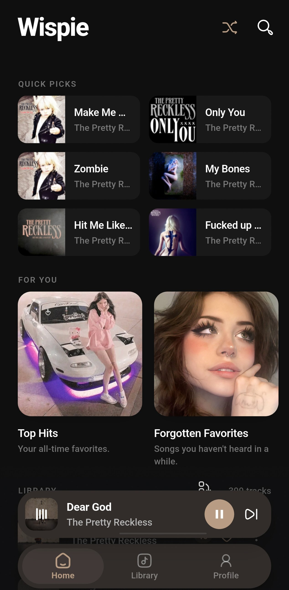
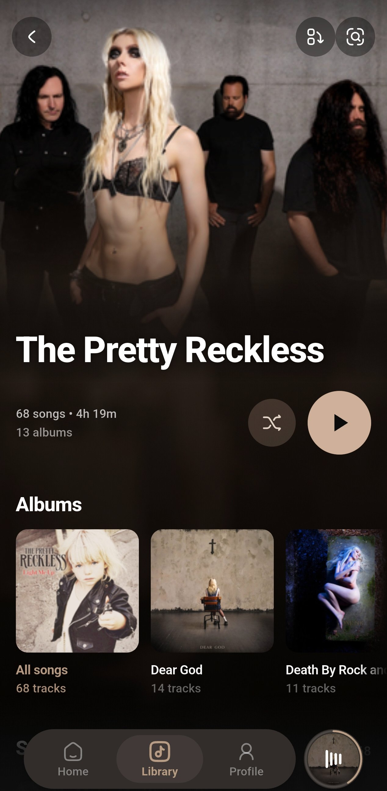

# wispie

  
  
  
  
  

  

wispie is an offline music player for the audio files already on your device. It plays your library, keeps track of what you finish and what you skip, and uses that history to decide what plays next.

[What it does](#what-it-does) | [Install](#install) | [Getting started](#getting-started) | [Tips](#tips) | [Privacy](#privacy) | [Screenshots](#screenshots) | [License](#license)

## What it does

### Playing music

- **Smart shuffle** - Picks what plays next from your listening history. See [How Smart shuffle works](#how-smart-shuffle-works).
- **Radio mode** - Shuffle keeps extending itself, so it never runs out of songs.
- **Transitions** - Fade in, fade out, or a fixed silence between tracks. Pick one; the others switch off.
- **Sleep timer** - Stop after a set time, a set number of tracks, or at the end of the current song. Can also loop one song for a set time.
- **Queue editing** - Reorder, remove, play next, shuffle what's up next, or clear it.
- **Queue history** - Up to 50 past queues are saved. Reopen any of them and play it now or after the current song.

### The player screen

  
  
  
  

- **Lyrics, player and queue in one screen** - Swipe between the three.
- **Synced lyrics** - Lyrics read from the file scroll line by line with the song. If the file only has line timings, wispie can estimate word-by-word timing.
- **Lyrics search** - Pull lyrics from multiple lyrics providers when a file has none, and write them back into the file.
- **Lyrics translation** - Translate lyrics into any of 28 languages. Show the translation under the original, or replace it.

### Your library

- **Point it at folders** - Add as many music folders as you want.
- **Supported formats** - mp3, m4a, wav, flac, ogg, wma, aac, m4b, opus, and video files (mp4, m4v, mov, mkv, webm, avi, 3gp).
- **Browse by folder, artist or album**
- **Search** - Across titles, artists, albums and lyrics, with filters.

### Editing your library

- **Edit metadata** - Change title, artist, album and cover art. Changes are written into the file.
- **Fetch missing covers and metadata** - Looks through Last.fm, Deezer and iTunes. Artist and album artwork is downloaded in the background while you use the app.
- **Bulk rename** - Rebuild filenames from a format you build out of title, artist, album, track number, year, and current name. Previews the result and flags collisions before anything moves.
- **Featured artists** - Move "ft." artists from the title into the artist field.

### Recommendations

wispie builds these from your play history and refreshes them daily:

- **Quick Picks** - Ten songs chosen for you
- **Top Hits** - Your 20 most played
- **Fresh Finds** - Newly added to your library
- **Forgotten Favorites** - Songs you liked but have not played recently
- **Quick Refresh** - Tracks you have barely played

### How Smart shuffle works

Smart learns from what you finish, what you skip, and what you play on repeat, then builds the queue in that order. The **Familiar to Discover** slider lets you lean toward songs you love or toward ones you have barely heard.

### Other shuffle modes

Also on Profile: **Explorer** (barely-played songs), **Consistent** (favorites), **Default** (balanced), **Custom** (your own weights).

### Your listening

- **Listening stats** - Plays, skips, tracks, and streak over 7 days, 30 days, 3 months, a year, or all time. Also when you listen, your top artists and songs, and how much of your library you have explored.
- **Song history** - Every song played, with timestamps
- **Session history** - Each listening session, broken down song by song
- **Listening insights** on your Profile tab

### Your data

- **Backups** - Export your stats, favorites, playlists and settings to a file, or export the caches too. Import restores them.
- **Storage screen** - See what covers, waveforms, lyrics and caches are taking up, and clear each one.
- **Encrypted sync** - Optional. Sign in and your stats, favorites, playlists, merged songs, settings and art choices sync to your account. Data is encrypted on the device before upload. Syncs by category, so you can leave playlists off if you don't want them there. A recovery key is the only way back into an account if you forget the password.

## Translations

See how far each language has come, or help translate, at [wispie.gru0.dev/translations](https://wispie.gru0.dev/translations).

## Install

Download the file for your platform from the [releases page](https://github.com/sillygru/wispie/releases/latest).

| Platform | File |
| --- | --- |
| Android | `wispie-arm64-v8a-release.apk` for most modern phones, `wispie-armeabi-v7a-release.apk` for older 32-bit ones (really old ones) |
| Windows | `wispie-windows-x64-setup.zip` to install, `wispie-windows-x64-portable.zip` to run without installing |
| macOS | `wispie-macos-arm64.zip` for Apple Silicon, `wispie-macos-x64.zip` for Intel |
| Linux | `wispie-linux-x86_64.AppImage.zip` |

## License

Copyright (c) 2026 gru — Licensed under GNU General Public License v3.0.

See [LICENSE](LICENSE) for full terms.
